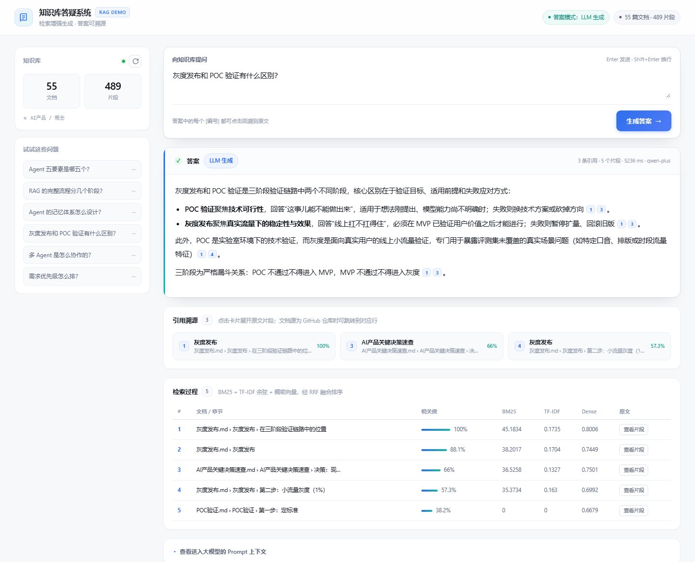
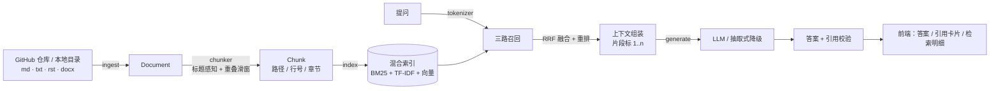

# AI 知识库答疑系统

把散在 Wiki 里的概念文档，变成「换个说法也能找到、每条结论都能点回原文」的问答。
**库里没有就明确说不知道，而不是编一个像模像样的答案。**



<p>


</p>

这是一个从零手写的 RAG 系统。检索层没有套 LangChain 或任何向量数据库 ——
BM25、TF-IDF、稠密向量三路各自实现，RRF 融合和重排都是自己写的。
理由很简单：这个项目值得讲的地方就在融合权重和重排公式里，套框架之后那些东西会变成一行
`Retriever(...)`，没人能打开文件指给你看。

## 三个值得看的地方

**1. 每条结论都能点回原文。**
答案里每个 `[n]` 都可点击，展开对应片段并显示文档、章节、行号区间（L42–L58）。
不是「答案看起来对」，是「你知道它从哪来」。

**2. 检索不是单路。**
BM25 抓精确词（错误码、版本号、`MCP` 这类英文术语），向量抓同义改写。
三路 RRF 融合后还有一层重排 —— 因为纯 RRF 会丢掉分数幅度，
而简单的 `max(词面, 语义)` 会让词面永远赢。这里改成两个因子的乘积，
Hit@1 从 66.7% 提到 75.0%，细节见 [架构文档](docs/architecture.md)。

**3. 有评测，而且数字是跑出来的。**
30 题、四类（直问 / 换说法 / 跨文档 / 域外拒答），题库和跑分脚本都在仓库里。
每次改动跑一遍，指标掉了立刻知道。过程中抓到过一个真实事故 ——
模型把文档里的「北京天气示例」改成「郑州」当事实回答，还挂了合法引用编号。
完整复盘见 [失败案例](docs/failure-cases.md)。

## 跑起来

```bash
git clone https://github.com/Easylove915/AI-Product-Concept-Q-A.git
cd AI-Product-Concept-Q-A
python app.py
```

打开 <http://127.0.0.1:8765>。

**不需要 API Key、不需要联网、不需要预先建索引。**
默认读取 `data/sample_docs/` 的 4 篇示例文档，首次启动自动建索引，
没有 Key 时自动降级为抽取式答案 —— 链路完整，只是不做归纳润色。

想换成真生成式答案：

```bash
cp .env.example .env
# 填 LLM_BASE_URL / LLM_API_KEY / LLM_MODEL，任意 OpenAI 兼容服务都行
```

命令行也能验证整条链路：

```bash
python scripts/cli.py status
python scripts/cli.py search "配额超了怎么办"
python scripts/cli.py ask "知识库支持哪些文档格式？"
python scripts/cli.py sync            # 改了文档后重建索引
```

界面支持用 `?q=` 预置问题，演示时可以直接把某个问题的完整效果发出去：

```
http://127.0.0.1:8765/?q=灰度发布和 POC 验证有什么区别
```

## 实测指标

55 篇 AI 产品概念文档 / 489 个片段，30 题评测集，`qwen-plus` + `text-embedding-v3`。

| 口径 | Hit@1 | Recall@5 | MRR | 误杀率 | 拒答准确率 |
| --- | --- | --- | --- | --- | --- |
| 稀疏检索（BM25 + TF-IDF） | 66.7% | 95.8% | 0.799 | 0% | 100% |
| **+ 稠密向量（三路混合）** | **75.0%** | **100.0%** | **0.875** | 0% | **100%** |
| 仅稀疏 + 规则门控（已废弃） | 54.2% | 70.8% | 0.625 | **29.2%** | 66.7% |

最后一行是这套评测最有价值的产出：规则门控把 Recall 砍掉 25 个点，
只换来 66.7% 的拒答准确率，还误杀 29.2% 的正常问题。**误杀比漏放伤害大得多**，
所以最终把拒答判断权交给了模型。完整对比和 Top-K 曲线见 [评测体系](docs/evaluation.md)。

## 架构



| 层 | 文件 | 职责 |
| --- | --- | --- |
| 接入 | `rag/ingest.py` | GitHub API / 本地目录，解析成统一 Document |
| 分块 | `rag/chunker.py` | 标题感知切节 + 重叠滑窗，保留行号用于溯源 |
| 分词 | `rag/tokenizer.py` | 中英混合（中文二元组 + 停用词） |
| 检索 | `rag/index.py` | BM25 + TF-IDF + 向量，RRF 融合 + 重排 |
| 向量 | `rag/embeddings.py` | 可插拔后端：openai / local / hashing / off |
| 生成 | `rag/generate.py` | prompt、LLM 调用、引用校验、降级 |
| 编排 | `rag/pipeline.py` | 串成 sync / search / ask |
| 服务 | `app.py`、`web/` | 标准库 HTTP 服务 + 无构建单页界面 |

## 目录

```
AI-Product-Concept-Q-A/
├── app.py · config.py          # 服务入口 / 配置
├── rag/                        # 检索与生成引擎（不依赖 Web，可单独 import）
├── web/                        # 单页界面，无构建步骤
├── scripts/cli.py              # 命令行：status / search / ask / sync
├── eval/                       # 评测脚本 + 30 题题库 + 历史快照
├── docs/                       # 深入文档（见下）
├── data/sample_docs/           # 内置示例文档
└── data/index/                 # 生成的索引（不入库，可重建）
```

## 深入文档

| 文档 | 讲什么 |
| --- | --- |
| [架构与实现](docs/architecture.md) | 三路检索实测对比、RRF 权重怎么定、重排为什么不能取 max、embedding 接入的工程坑 |
| [评测体系](docs/evaluation.md) | 题库设计、五个指标的口径、三套基线、Top-K 曲线 |
| [失败案例](docs/failure-cases.md) | 示例数据污染（D03）与同义改写召回失败（B04）的完整复盘 |
| [设计取舍](docs/design-decisions.md) | 为什么关掉规则门控、已知局限、升级到生产的路线 |

## 已知限制

这些都是真话，不是免责声明：

- **不是 Agent。** `ask()` = 一次检索 + 一次生成，没有工具调用、没有决策循环、没有多轮。
  所有问题走同一条固定路径。
- **引用校验只到编号级。** `verify_citations()` 只查编号是否越界，不做实体级忠实度校验。
  D03 那种「编号合法但主语被换掉」的情况目前靠 prompt 兜着。
- **中文分词是二元的。** 没有 jieba，会切出「的完」「整流」这类跨词边界的伪词，
  这也是规则门控失效的根因。换 jieba 是下一步。
- **单进程、无流式。** LLM 调用包在全局锁里，多线程实际串行；答案一次性返回，平均等 3.5 秒。

## License

[MIT](LICENSE)
